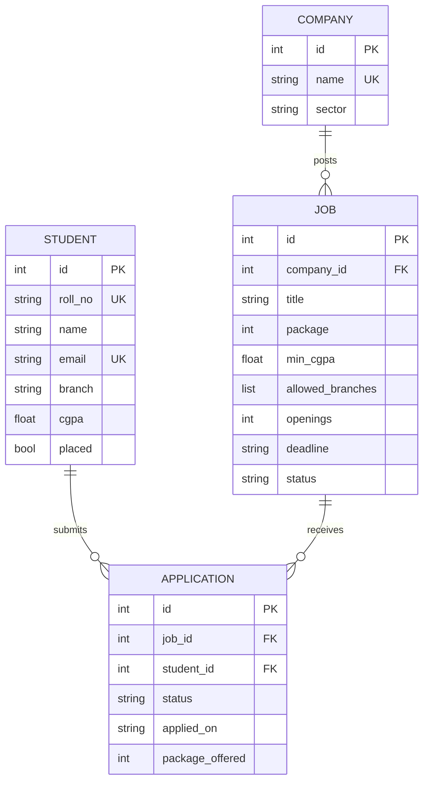

# Campus Placement Portal API

A complete small Python API project: students, companies, jobs, applications, three roles (officer, recruiter, and student), rules (CGPA cutoff, branch eligibility, max 5 active applications, deadline, acceptance cascade) and data saved in JSON files. No database.

---

## Run

```bash
pip install -r requirements.txt
uvicorn main:app --reload
```

Open **[http://127.0.0.1:8000/docs](http://127.0.0.1:8000/docs)** in your browser.

The first start automatically creates `students.json`, `companies.json`, `jobs.json`, and `applications.json` next to `main.py`.

**Clean start:** Stop the server, delete those four files, and start the server again.

---

## Starter Data

On a clean start, the files are populated with:
- **5 Students**:
  - `1`: Aarav Sharma (CSE, 9.1 CGPA)
  - `2`: Diya Patel (ECE, 8.4 CGPA)
  - `3`: Rohan Verma (ME, 7.2 CGPA)
  - `4`: Ananya Iyer (CE, 6.2 CGPA)
  - `5`: Kabir Singh (EE, 7.9 CGPA)
- **3 Companies**:
  - `1`: TechCorp (Software)
  - `2`: ElectroWave (Electronics)
  - `3`: AutoMotors (Automobile)
- **4 Jobs**:
  - `1`: TechCorp - Software Development Engineer (₹18 LPA, Min CGPA 8.0, Branches: CSE & ECE, Openings: 3, Deadline: 2026-12-31)
  - `2`: TechCorp - Data Scientist (₹22 LPA, Min CGPA 8.5, Branch: CSE, **Openings: 1**, Deadline: 2027-01-15)
  - `3`: ElectroWave - Hardware Systems Engineer (₹12 LPA, Min CGPA 7.0, Branches: ECE & EE, Openings: 2, Deadline: 2027-02-28)
  - `4`: AutoMotors - Mechanical Design Specialist (₹9 LPA, Min CGPA 6.0, Branches: ME & CE, Openings: 4, Deadline: 2027-03-31)
- **0 Applications**: Empty list `[]`

---

## Roles

Send a header `X-Role: officer`, `X-Role: recruiter`, or `X-Role: student`.
- A **recruiter** also sends `X-Company-Id: <id>` (integer). A recruiter can only create, edit, or see things belonging to their company.
- A **student** also sends `X-Student-Id: <id>` (integer). A student can only see or edit their own profile and applications.
- An **officer** runs the placement cell and can do everything.

In `/docs`, click any endpoint, click **"Try it out"**, and type the values into the header boxes.

- No header, or an unknown role $\rightarrow$ `401`
- A known role that is not allowed $\rightarrow$ `403`
- `GET /health`, `GET /companies`, `GET /jobs`, and `GET /jobs/{id}` need no role (accessible by anyone).

---

## Rules

- **Eligibility**: Student CGPA must meet or exceed `min_cgpa` (**R4**), and their branch must be in `allowed_branches` (**R5**).
- **Deadlines & Status**: Cannot apply if today is after the deadline (**R2**) or if the job is closed (**R1**).
- **Active Limit**: A student holds at most 5 active applications at the same time (`applied`, `shortlisted`, `offered`) (**R7**).
- **No Duplicates**: A student cannot apply twice to the same job (**R6**).
- **Offering a Job**: Requires `remaining_openings > 0` and unplaced student (**R9**). Copies the job's package into `package_offered`.
- **Acceptance Cascade**: Accepting an offer marks student `placed=True` and automatically sets all other active applications to `withdrawn` (**R10**). Accepting twice gives `409`. Placed students cannot apply to new jobs (**R3**).
- **Deletions**: Cannot delete a job with applications (**R11**) or a company with jobs (**R12**).
- **Date Check**: A status transition cannot happen before the application date (`400`).

---

## Models & Links



---

## All 18 Endpoints

| # | Method | Path | Allowed Roles | Description | Status Codes |
|---|---|---|---|---|---|
| 1 | `GET` | `/health` | Anyone | Server health check | 200 |
| 2 | `POST` | `/students` | Officer | Register a new student | 201, 401, 403, 409, 422 |
| 3 | `GET` | `/students` | Officer | List students (filter by `branch`, `placed`) | 200, 401, 403, 422 |
| 4 | `GET` | `/students/{id}` | Officer, Student (own) | Get single student details | 200, 401, 403, 404 |
| 5 | `PATCH` | `/students/{id}` | Officer | Update student fields | 200, 401, 403, 404, 409, 422 |
| 6 | `POST` | `/companies` | Officer | Register a company | 201, 401, 403, 409, 422 |
| 7 | `GET` | `/companies` | Anyone | List all companies | 200 |
| 8 | `DELETE` | `/companies/{id}` | Officer | Delete company (if no jobs) | 204, 401, 403, 404, 409 |
| 9 | `POST` | `/jobs` | Officer, Recruiter (own) | Post a job opening | 201, 401, 403, 404, 422 |
| 10 | `GET` | `/jobs` | Anyone | List jobs (filters: `branch`, `min_package`, `open_only`, `today`) | 200, 422 |
| 11 | `GET` | `/jobs/{id}` | Anyone | Get job by ID with computed openings | 200, 404 |
| 12 | `PATCH` | `/jobs/{id}` | Officer, Recruiter (own) | Update job fields or change status | 200, 401, 403, 404, 409, 422 |
| 13 | `DELETE` | `/jobs/{id}` | Officer | Delete job (if no applications) | 204, 401, 403, 404, 409 |
| 14 | `POST` | `/applications` | Student (own) | Submit job application | 201, 401, 403, 404, 409, 422 |
| 15 | `GET` | `/students/{id}/applications` | Officer, Student (own) | List applications of a student | 200, 401, 403, 404 |
| 16 | `GET` | `/applications` | Officer, Recruiter (own) | List applications (filter by `status`) | 200, 401, 403, 422 |
| 17 | `PATCH` | `/applications/{id}/status` | Officer, Recruiter (own), Student (own) | Move application status | 200, 400, 401, 403, 404, 409 |
| 18 | `GET` | `/stats` | Officer | Placement report | 200, 401, 403, 422 |

---

## Testing

1. **Clean start**: Stop the server, delete the four JSON files, start server again (`uvicorn main:app --reload`).
2. **Interactive testing**: Open `/docs` and test using the checklist below.
3. **Automatic check script**: Run `python check_placement.py` in a second terminal (runs all 60+ automated checks).
4. **Restart test (by hand)**: Stop the server, start it without deleting files, check that your data is still there.
5. **Damaged-file test (by hand)**: Corrupt a JSON file with bad text, start server, and verify safe loading restores starter data without crashing.

`?today=YYYY-MM-DD` on `POST /applications`, `PATCH /applications/{id}/status`, `GET /jobs` and `GET /stats` pretends today is that date, so deadlines can be tested easily.

---

## Test Checklist (38 Rows)

| # | Request (method, path, role, body) | State needed | Expected status | Expected reply or effect |
|---|---|---|---|---|
| 1 | `GET /health` (No headers) | Clean start | `200` | `{"status": "ok"}` |
| 2 | `POST /students` (No `X-Role`) `{...}` | Clean start | `401` | Missing or invalid X-Role header |
| 3 | `POST /students` (`X-Role: dean`) `{...}` | Clean start | `401` | Unknown role rejected |
| 4 | `POST /students` (`X-Role: student`, `X-Student-Id: 1`) `{...}` | Clean start | `403` | Role student not permitted |
| 5 | `POST /students` (`X-Role: recruiter`, `X-Company-Id: 1`) `{...}` | Clean start | `403` | Role recruiter not permitted |
| 6 | `POST /jobs` (`X-Role: recruiter`, no `X-Company-Id`) `{...}` | Clean start | `401` | Missing X-Company-Id header |
| 7 | `POST /applications` (`X-Role: student`, no `X-Student-Id`) `{...}` | Clean start | `401` | Missing X-Student-Id header |
| 8 | `POST /jobs` (`X-Role: recruiter`, `X-Company-Id: 1`, body `company_id: 2`) | Clean start | `403` | Recruiter cannot create job for company 2 |
| 9 | `GET /students/2` (`X-Role: student`, `X-Student-Id: 1`) | Clean start | `403` | Student 1 cannot view Student 2 |
| 10 | `POST /applications` (`X-Role: student`, `X-Student-Id: 1`, body `student_id: 2`) | Clean start | `403` | Student 1 cannot apply for Student 2 |
| 11 | `GET /companies` (No headers) | Clean start | `200` | Returns 3 starter companies |
| 12 | `POST /companies` (`X-Role: officer`, name: `"techcorp"`, sector: `"IT"`) | Clean start | `409` | Company name already exists (case-insensitive) |
| 13 | `POST /companies` (`X-Role: officer`, name: `""`, sector: `"IT"`) | Clean start | `422` | Name validation failure (min length 1) |
| 14 | `POST /companies` (`X-Role: officer`, name: `"InnoSoft"`, sector: `"Cloud"`) | Clean start | `201` | Company created with ID 4 |
| 15 | `DELETE /companies/1` (`X-Role: officer`) | Clean start | `409` | Cannot delete company with existing jobs (R12 break) |
| 16 | `DELETE /companies/4` (`X-Role: officer`) | Company 4 created | `204` | Company 4 deleted (R12 obey) |
| 17 | `POST /students` (`X-Role: officer`, roll_no: `"2026CSE001"`, ...) | Clean start | `409` | Roll number already exists |
| 18 | `POST /students` (`X-Role: officer`, email: `"AARAV@EXAMPLE.COM"`, ...) | Clean start | `409` | Email already exists (case-insensitive) |
| 19 | `POST /students` (`X-Role: officer`, email: `"bademail"`, ...) | Clean start | `422` | Regex validation failure for email |
| 20 | `POST /students` (`X-Role: officer`, cgpa: `10.5`, ...) | Clean start | `422` | CGPA exceeds 10.0 limit |
| 21 | `POST /students` (`X-Role: officer`, roll_no: `"2026CSE006"`, cgpa: `8.8`, ...) | Clean start | `201` | Student created with ID 6 |
| 22 | `GET /students?branch=CSE` (`X-Role: officer`) | Clean start | `200` | Returns only CSE students |
| 23 | `GET /students?branch=UNKNOWN` (`X-Role: officer`) | Clean start | `422` | Branch not in Literal validation |
| 24 | `GET /jobs?open_only=true&today=2027-01-01` (No headers) | Clean start | `200` | Job 1 (deadline 2026-12-31) is hidden |
| 25 | `GET /jobs/1` (No headers) | Clean start | `200` | Returns Job 1 with `filled_openings: 0`, `remaining_openings: 3` |
| 26 | `POST /applications?today=2027-01-01` (`student`, `sid: 1`, job: 1, student: 1) | Clean start | `409` | Job deadline has passed (R2) |
| 27 | `POST /applications` (`student`, `sid: 4`, job: 1, student: 4) | Clean start | `409` | Student CGPA 6.2 < Job 1 min 8.0 (R4) |
| 28 | `POST /applications` (`student`, `sid: 3`, job: 1, student: 3) | Clean start | `409` | Student ME branch not in CSE,ECE (R5) |
| 29 | `POST /applications` (`student`, `sid: 1`, job: 1, student: 1) | Clean start | `201` | Application 1 created with status `applied` |
| 30 | `POST /applications` (`student`, `sid: 1`, job: 1, student: 1) | App 1 exists | `409` | Duplicate application to same job (R6) |
| 31 | `DELETE /jobs/1` (`X-Role: officer`) | App 1 exists | `409` | Cannot delete job with existing applications (R11) |
| 32 | `POST /applications` (`student`, `sid: 2`, 6th application) | Student 2 has 5 apps | `409` | Maximum active applications limit reached (R7) |
| 33 | `PATCH /applications/1/status` (`student`, `sid: 1`, status: `"shortlisted"`) | App 1 applied | `403` | Student cannot set shortlisted status |
| 34 | `PATCH /applications/1/status?today=2020-01-01` (`officer`, status: `"shortlisted"`) | App 1 applied | `400` | Status change cannot happen before application date |
| 35 | `PATCH /applications/1/status` (`officer`, status: `"offered"`) | App 1 shortlisted | `200` | Status moves to offered; package 1800000 copied (R9) |
| 36 | `PATCH /applications/1/status` (`student`, `sid: 1`, status: `"accepted"`) | App 1 offered | `200` | Student placed=True; other active apps auto-withdrawn (R10) |
| 37 | `PATCH /applications/1/status` (`student`, `sid: 1`, status: `"accepted"`) | App 1 accepted | `409` | Cannot transition already accepted app (R8, no 2nd cascade) |
| 38 | `GET /stats` (`X-Role: officer`) | App 1 accepted | `200` | Detailed stats, total_students, average_package, top company |

---

## Files

- `main.py` - The entire API in one file (Settings, Storage, Models, Helpers, Endpoints)
- `check_placement.py` - Automatic test checklist
- `requirements.txt` - Dependencies (`fastapi==0.115.6`, `uvicorn==0.34.0`, `requests`)
- `.gitignore` - Ignores runtime JSON files and python caches
